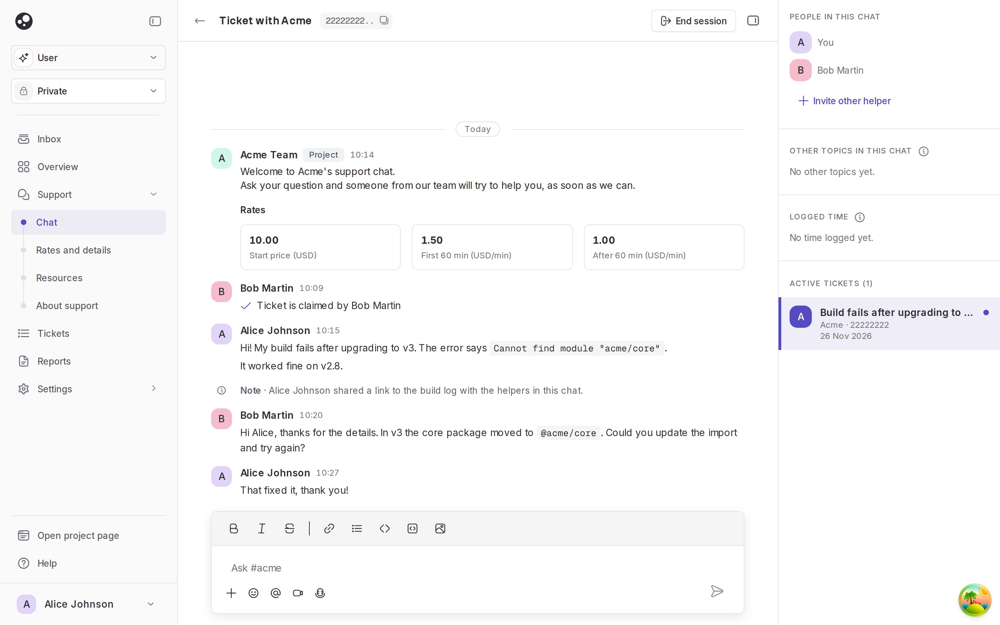
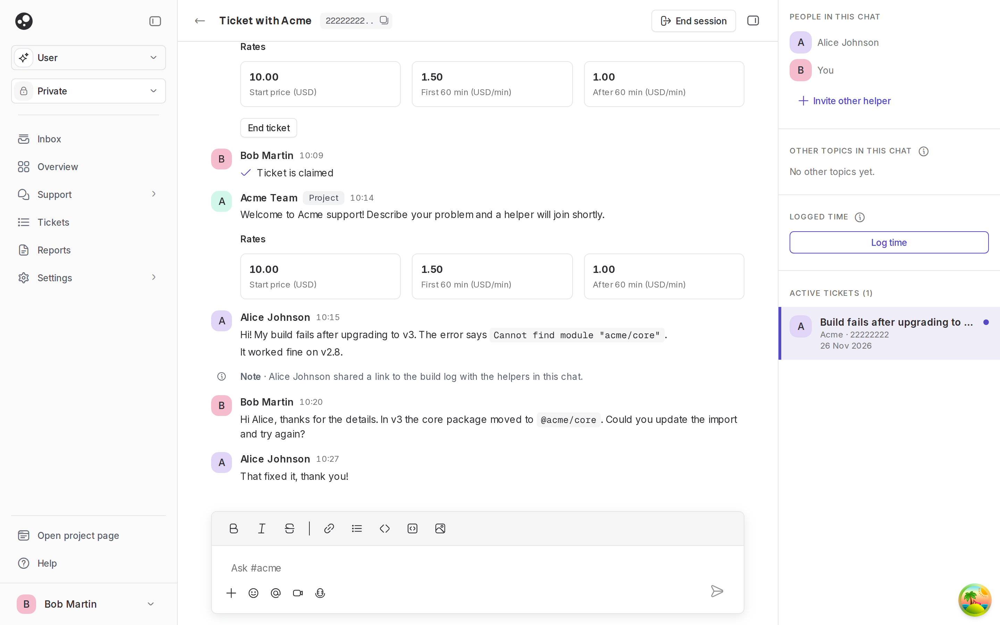
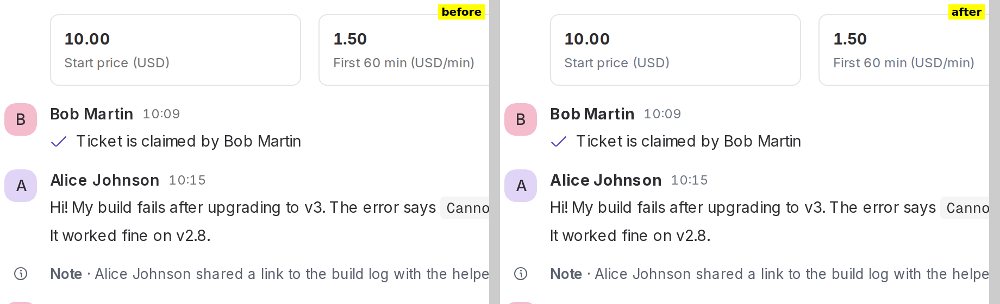
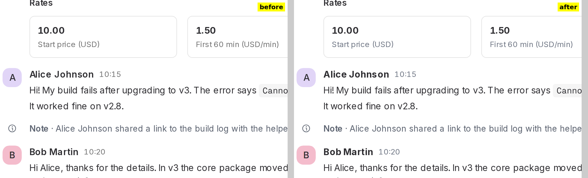

## Chat text styling: bold sender names, `text-chat-meta` for timestamps and rate labels

Sender names in the chat thread are now bold, and message timestamps and rate labels use a new `text-chat-meta` token (#707785). This applies to the customer chat (`/support/[slug]` and `/support/chat`) and to the helper/admin ticket page (`/helper/tickets/[id]`).

### Audit list

| Element | Where | Before | After |
|---|---|---|---|
| Sender name (helpers, customers, "{Project} Team") | `ChatMessageMeta` in `chat-message-parts.tsx`, used by `TicketChat`, `CustomerChatIntro` and the helper ticket page | `text-sm font-semibold text-foreground` | `text-sm font-bold text-foreground` |
| Message timestamp (`HH:MM`) | `ChatMessageMeta` | `text-xs text-muted-foreground` (#737373) | `text-xs text-text-chat-meta` (#707785) |
| Rate labels ("Start price (USD)", "First 60 min (USD/min)", "After 60 min (USD/min)") | `customer-chat-intro.tsx` (customer view) | `text-xs text-muted-foreground` | `text-xs text-text-chat-meta` |
| Rate labels, same three | `helper/tickets/[id]/page.tsx` (welcome message in the helper thread) | `text-xs text-muted-foreground` | `text-xs text-text-chat-meta` |

Checked and left unchanged on purpose:

- **Guest name** (`GuestName`, e.g. "Guest · a1b2"): stays `font-normal text-muted-foreground`. Its test assertion in `guest-ticket.test.tsx` is unchanged.
- **System note** (`SystemNote`, "Note · …"): stays `text-ui text-text-note`. See the note on `text-note` below.
- **Rate values** (10.00 / 1.50 / 1.00): already `text-sm font-bold text-foreground`.
- **Welcome text, "Rates" heading, day divider ("Today")**: unchanged.
- **"Free support" and "rates not configured" body copy** (`text-sm text-muted-foreground`): these are sentences, not labels, so they are unchanged.

### Files changed

- `src/app/globals.css`: new `--text-chat-meta: #707785` in `:root` and `--color-text-chat-meta` in `@theme`. The chat-thread comment now mentions it.
- `src/components/ticket-chat/chat-message-parts.tsx`: sender name `font-semibold` → `font-bold`; timestamp `text-muted-foreground` → `text-text-chat-meta`.
- `src/components/ticket-chat/customer-chat-intro.tsx`: the three rate labels → `text-text-chat-meta`.
- `src/app/helper/tickets/[id]/page.tsx`: the three rate labels → `text-text-chat-meta`.
- `src/components/ticket-chat/customer-chat-intro.test.tsx`: two new assertions. The name has `font-bold` (not `font-semibold`), the time has `text-text-chat-meta` (not `text-muted-foreground`), and all three rate labels have `text-text-chat-meta`.
- `CLAUDE.md`: added `text-chat-meta` #707785 (chat timestamps and rate labels, light only) to the colour tokens row.

No existing test asserted `font-semibold` or `text-muted-foreground` on the sender name, timestamp or rate labels. That includes `ticket-chat.test.tsx` and `guest-ticket.test.tsx`, so neither needed changes.

### Token naming rationale

The new token is named `text-chat-meta` after its role, not its value or a generic grey step:

- It follows the existing chat-thread family in `globals.css` (`text-note`, `text-empty`, `composer-border-focus`). These are light-only tokens scoped to the chat thread, and the new token is too.
- "meta" describes what it styles: secondary information about a message (when it was sent, what a number means), as opposed to the message content or a system note.
- It is not a reuse of `muted-foreground` (#737373, neutral grey) or `text-tertiary` (#666B77). #707785 is a cooler blue-grey that matches the rest of the chat palette, and changing either shared token would recolour list cells, hints and subtitles across the app.
- Like `text-note`, it has no `.dark` entry, so dark mode is unchanged by this PR.

### Note on `text-note`

The brief gives the system-note colour as **#5D636F**. In the code, `--text-note` is `var(--badge-muted-text)`, which is **#5c6370**. The difference is one step on each channel and can't be seen. It was **left unchanged** so the system note keeps following the muted badge grey instead of adding a near-duplicate token.

### Screenshots (light mode, `npm run dev`, 1440×900 @2x)

Each pair shows the project welcome message with rates, a system note ("Note · …") and messages from two people (Alice Johnson, customer; Bob Martin, helper).

**Customer view: `/support/chat?ticket=…`** (the `/support/[slug]` chat)

| Before | After |
|---|---|
|  |  |

**Helper/admin ticket page: `/helper/tickets/[id]`**

| Before | After |
|---|---|
|  |  |

**Close-ups** (left before, right after: names are bolder, and times and rate labels are the bluer #707785):

The screenshots use fixture data: all Supabase requests were answered by a Playwright route stub, so nothing was read from or written to the real project.

### Verification

- `npm run lint`: 0 errors (2 existing `` warnings in payout/payment settings)
- `npm run test`: 101 files, 955 tests passed before the new assertions; `src/components/ticket-chat` 95/95 after them
- `npx next build`: passes

🤖 Generated with [Claude Code](https://claude.com/claude-code)
